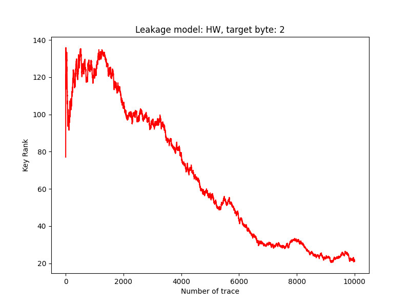

# Weekly Update

## Done

1. The experiment on the TF dataset was successfully run. The key was successfully recovered after training with 1000 traces. The backbone used was CNN_Best_Norm. The ranking curve is as below:

2. Experiments on ASCAD Masked

I continued evaluating the PyTorch implementation on the ASCAD Masked dataset.

A baseline experiment was conducted using 2,000 profiling traces, a fixed per-class sampling limit of U=300, and 100 training epochs. The model used cosine-based Triplet Loss and kNN classification for key recovery.

The ranking curve for the Fixed U experiment is shown below:

3. Investigation of training stability

Several experiments were conducted to investigate the instability of key recovery on ASCAD Masked, including:

- Increasing the number of training epochs.

- Comparing different random seeds.

- Experimenting with Dynamic U sampling, where the selected training traces are updated between epochs.

- Testing different negative mining strategies and batch shuffling.

- Exploring class-weighted Triplet Loss.

Dynamic U improved the results in several experiments. However, none of the tested modifications consistently achieved Rank 0 across different random seeds and training epochs.

## Block
1. The experimental results could not be perfectly reproduced on the TF dataset.

 Stable success was only achieved with 1000 training traces; at 500 and 800 traces, the final key rank remained between 2 and 5. The original TensorFlow implementation also did not reproduce the expected results under my current evaluation setup. One possible explanation is a difference in the attack trace selection, since I used the last 10,000 traces for evaluation

2. Stable key recovery on ASCAD Masked remains unresolved.

Although the correct key was successfully recovered in several experiments, the results were sensitive to the random seed and training epoch. In some cases, a model achieved Rank 0 at an earlier checkpoint but produced a worse key rank after additional training.

This makes it difficult to identify a training configuration that reliably recovers the correct key.

